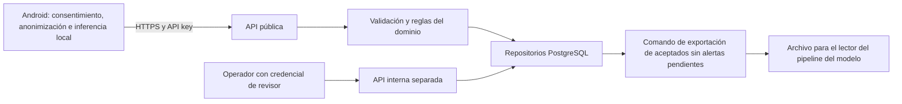

# Arquitectura, datos y operación del backend

Fuente central del equipo, revisada contra código el **8 de noviembre de 2026**.
Describe lo existente y sus límites; no sustituye el modelo original de la tesis,
que aún debe contrastarse para cerrar #4.

## Qué está integrado y qué está en revisión

`main` en `03800d594c2c18a12ccc0c3c8395124afdf816d1` contiene la base FastAPI,
PostgreSQL y repositorios de #3/#8/#9, además de la automatización del Project.
En main solo está publicada por código la ruta de salud; no existe despliegue.

La API de aportes y sus protecciones están implementadas en PR apilados. La
versión funcional completa contrastada es
[`1dc7862`](https://github.com/smishing-thesis/smishing-backend/tree/1dc7862af984f5dd9de2307ff2bf49073f36255b),
con 154 pruebas y CI verde. #15/#13/#16 tienen PR #38/#39/#40 listos para revisar;
#14 tiene el borrador #41. Describirlos aquí no significa que estén en main.

## Responsabilidades

La app Android comprueba consentimiento, anonimiza y clasifica con Char-CNN/LiteRT
local. El backend recibe voluntariamente texto ya anonimizado y la etiqueta que
declara la app. No recibe el SMS original para clasificarlo, no ejecuta Char-CNN,
no entrena y no envía órdenes a los dispositivos.

| Capa | Responsabilidad | Frontera |
| --- | --- | --- |
| API y servicios | Contratos HTTP, credenciales, cuotas y composición de casos de uso | No incorpora SQL en rutas |
| Dominio | Entidades, puertos, normalización, verificación residual y señales del corpus | Sin imports de FastAPI o SQLAlchemy |
| Datos | PostgreSQL, transacciones, migraciones, catálogo y publicación de archivos | Implementa los puertos del dominio |

La detección de nombres de spaCy comprueba datos residuales; **no clasifica
smishing**. Las heurísticas de calidad tampoco reemplazan al modelo Android.

## Modelo de datos y privacidad

El esquema completo de la versión funcional se reconstruye con migraciones
0001–0005; main actualmente tiene 0001. No aplicar versiones posteriores desde
una rama que no contiene su implementación.

| Tabla | Contenido y relaciones | Disponibilidad |
| --- | --- | --- |
| contributions | UUID del aporte, texto anonimizado, hash único, fecha de recepción del servidor y estado | Main, 0001; fecha/motivo de revisión en 0002 |
| labels | Etiqueta y referencia opcional al modelo; FK al aporte | Main, 0001; origen y fecha en 0003 |
| model_versions | Referencia de versión; metadatos agregados importados de una publicación | Referencia en main; catálogo completo en 0003 |
| reviews | Revisor interno, decisión, motivo, fecha y etiqueta manual del mismo aporte | PR #39, 0004 |
| risk_flags | Tipo de señal, aporte afectado y revisión posterior atribuida | Borrador #41, 0005 |
| alembic_version | Versión técnica del esquema | Main |

En 0003, una etiqueta de origen `device` exige modelo y una `manual` lo prohíbe.
Se conservan ambas. Los IDs de revisor son seudónimos de operadores autorizados;
no identifican a las personas que contribuyen ni a sus celulares.

Nunca se solicitan ni se almacenan como metadatos del aporte: teléfono del
remitente/receptor, ID de instalación/dispositivo, dirección de red, cuenta de
usuario, contactos, fecha original del SMS o credenciales. UUID y hash identifican
el **aporte/contenido**, no al contribuyente. El dominio no recibe la dirección de red.

El limitador de API usa temporalmente un HMAC del par de red inmediato con sal
por ventana, solo en memoria. El mapa y la sal expiran incluso sin tráfico;
no se escriben en PostgreSQL o logs. Los valores de claves viven en configuración,
no en las tablas. Un hash o conjunto de trigramas no garantiza anonimato por sí solo.

El texto recibido puede contener datos residuales que los detectores no reconozcan:
NER tiene falsos positivos/negativos y las reglas de teléfonos/documentos tienen
alcance limitado. Por eso no se garantiza anonimización perfecta y existe revisión.

## Flujo de un aporte

1. Android obtiene consentimiento y realiza inferencia/anonimización local.
2. La API comprueba `X-API-Key` antes de leer el cuerpo o entrar al dominio.
   Sin clave activa devuelve 401. No hay identificación de contribuyente.
3. Aplica cuotas configurables por ventana: exceso da 429 con Retry-After.
   Son cuotas por proceso; varias réplicas necesitan una solución compartida.
4. Lee un máximo de 16384 bytes: JSON UTF-8, campos estrictos `text`, `label`,
   `model_version`, sin campos desconocidos ni claves JSON repetidas.
5. Normaliza NFC, controles y espacios; exige texto de 1–2048 puntos Unicode y
   versión con formato documentado. Calcula SHA-256 después de normalizar.
6. Repite detectores de enlaces, correo, móvil peruano, DNI/RUC y nombres. Si
   detecta residuales, devuelve 422 sin persistir el texto ni eco en el error.
7. En la versión de #14 analiza señales de calidad antes de guardar. Un hash ya
   existente da 409, sin revelar estado/ID; una contradicción puede marcar solo
   el registro existente, sin guardar el cuerpo del envío duplicado.
8. Guarda aporte, etiquetas y marcas en una transacción. Nace `pending`, nunca
   directamente aceptado. Un fallo revierte las escrituras; error genérico 503.
9. El revisor entra a **otra aplicación**, con Bearer distinto de la API key.
   Lista pendientes, acepta/rechaza y elige etiqueta manual. Se registran ID
   autorizado, decisión y fecha junto a la etiqueta, de forma atómica.
10. Un marcado requiere reconocimiento explícito de sus alertas. Si una nueva
    señal afecta a un aceptado, se excluye de entrenamiento hasta revisión.
11. El comando de exportación selecciona solo `accepted` sin alertas pendientes,
    prioriza la última etiqueta manual y usa la automática si no existe manual.
    Genera CSV/manifiesto reproducibles, sin metadatos de contribuyente o revisor.

Errores públicos nunca contienen el SMS ni los valores rechazados. La revisión
interna no aparece en OpenAPI público. No hay endpoint público de descarga.

## Contrato y decisiones de diseño

El contrato versionado implementado está en
[OpenAPI](https://github.com/smishing-thesis/smishing-backend/blob/1dc7862af984f5dd9de2307ff2bf49073f36255b/docs/openapi-v1.json).
Las etiquetas públicas propuestas son `safe` y `smishing`; el lector del modelo
consume 0/1 en la exportación. La longitud de entrada del modelo no se confunde
con el límite de almacenamiento del aporte.

- [Contrato y revisión pendiente #4](https://github.com/smishing-thesis/smishing-backend/issues/4): comparar con el documento original de base de datos indicado por el equipo. No consta esa comprobación todavía.
- [Autenticación #6](https://github.com/smishing-thesis/smishing-backend/issues/6): el usuario comunicó el 8 de noviembre la aceptación del mecanismo API key. La clave es extraíble de Android y no prueba procedencia oficial. No se afirma una reunión o aceptación directa de terceros.
- Rotación: añadir clave nueva por entorno, reiniciar, distribuir cliente y retirar
  la anterior de todos los procesos. Revisar en cada publicación del cliente y
  revocar ante filtración; no hay vencimiento/recarga automáticos. La distribución
  del cliente debe coordinarse: revocar puede impedir aportes de versiones antiguas,
  pero no desactiva su inferencia local. No se comparte clave con revisores.
- [Revisión y cuarentena](https://github.com/smishing-thesis/smishing-backend/blob/1dc7862af984f5dd9de2307ff2bf49073f36255b/docs/protected-review.md): estados terminales y auditoría, sin inventar revisores históricos.
- [Catálogo y etiquetas](https://github.com/smishing-thesis/smishing-backend/blob/1dc7862af984f5dd9de2307ff2bf49073f36255b/docs/label-provenance.md): importa solo agregados de publicaciones; no descarga corpus para clasificar.
- [Señales #14](https://github.com/smishing-thesis/smishing-backend/blob/1dc7862af984f5dd9de2307ff2bf49073f36255b/docs/poisoning-signals.md): umbrales iniciales configurables, sin afirmar calibración real. Sin referencias operativas no hay comparación con evaluación.
- [Exportación](https://github.com/smishing-thesis/smishing-backend/blob/1dc7862af984f5dd9de2307ff2bf49073f36255b/docs/corpus-export.md): lector estándar real probado; no se modifica el experimento histórico de corpus congelado.

## Operación inicial y pendientes

Usar variables de entorno/gestor de secretos. No hay carga automática de `.env`.
Aplicar migraciones de la rama elegida antes de servir tráfico; downgrade destruye
información y se ensaya solo en base aislada. Los runners funcionales exigen TLS,
desactivan access logs y proxy headers, y escuchan en loopback por defecto:
`python -m smishing_backend.server` (8443) y `python -m smishing_backend.review_server`
(8444). Estos módulos aún no están integrados en main.

Política inicial recomendada para #17, delegada por el usuario:

- Logs de eventos sin contenido/credenciales/red: 7 días, rotación diaria.
  El handler local existente mantiene seis históricos y uno activo; la poda ocurre
  al rotar, de modo que un servicio detenido requiere limpieza antes de reiniciar.
  No es una prueba de borrado automático por edad durante inactividad.
- Respaldos diarios cifrados de corpus y auditoría, con acceso restringido y 7 días
  de retención. No respaldar secretos, corpus originales ni carpetas del dispositivo.
- Objetivo inicial de pérdida máxima: 24 horas con respaldo diario (RPO). Objetivo
  de recuperación propuesto: 24 horas (RTO). Son objetivos, no resultados medidos.
- Probar una restauración aislada antes del despliegue y al cambiar esquema o
  procedimiento; después, una comprobación mensual como punto de partida.

Estas recomendaciones **no equivalen a respaldos configurados o restauración
probada**. #17 sigue pendiente de verificación operativa. #18 tiene CI verde/roja
controlada, pero falta exigir su check en protección de main; un test verde no
bloquea merges por sí solo. Azure/red privada/secretos/TLS/CORS de despliegue son
#19/#20 y no se han configurado ni desplegado en esta sesión.

Actualización de evidencia: se completó un [simulacro local cifrado de respaldo
y restauración](backup-policy.md) con datos sintéticos y el esquema funcional
0005. No equivale a programación, retención o recuperación de producción.

## Revisión del documento contra el código

Se contrastaron las siguientes piezas del commit funcional fijado arriba:

| Afirmación | Fuente comprobada |
| --- | --- |
| Campos, formatos y límites HTTP | api/contracts.py, api/validation.py, api/contributions.py |
| Credencial antes de dominio/cuerpo y rotación | api/authentication.py, config.py |
| Cuotas y expiración | api/rate_limit.py |
| Normalización y verificación residual | domain/text.py, domain/privacy.py, domain/contributions.py |
| Tablas, columnas y restricciones | data/schema.py y migrations/versions/0001–0005 |
| Transacción, duplicados y señales | data/repositories/contributions.py y poisoning.py |
| Revisión separada/actor y límites | review.py, review_auth.py, data/repositories/review.py |
| Selección de aceptados y bytes reproducibles | data/repositories/quarantine.py, domain/corpus_export.py, data/export_files.py |
| Logs y retención real del handler | logging.py, server.py, review_server.py |

CI de esa revisión funcional:
[154 pruebas, tipos, formato, contrato y migraciones en verde](https://github.com/smishing-thesis/smishing-backend/actions/runs/42518509872).
Incluye PostgreSQL real y datos sintéticos, con 0/20 controles normales marcados
por las heurísticas en esa muestra. No se reentrenó ni se probó producción.

Este cambio documental no añade rutas, campos ni funcionalidades: conserva la
distinción entre main, implementación en PR y operación todavía no verificada.
